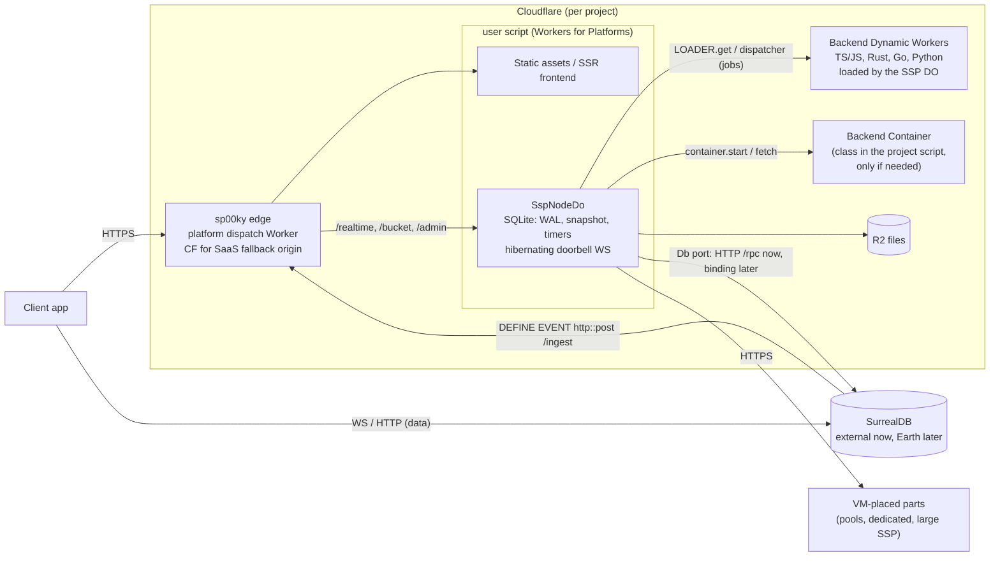

# Cloudflare-native sp00ky: isolate-first, scale to zero, SurrealDB Earth ready

This is the design for making Cloudflare the default home of every new sp00ky
cloud project, on every plan. It covers the data plane (this repo): the SSP as
a Durable Object that sleeps and wakes fast, standalone parity for jobs,
schedules and push, Worker-native backends in four languages, the database
provider seam for SurrealDB Earth, and a realtime doorbell. The control plane
side lives in `spooky-cloud/docs/21-cloudflare-default-platform.md`.

Status: **design + spikes.** Nothing here is shipped yet. Section 11 lists the
spikes that gate implementation and links their result files.

Related: [`platform-architecture.md`](platform-architecture.md) (the portable
SSP core and its ports, which this design builds on),
[`ssp-app.md`](ssp-app.md) (VM SSP internals),
`spooky-cloud/docs/13-cloudflare-platform-plan.md` (the earlier free-tier
plan; its own DB-in-a-Durable-Object section is superseded by SurrealDB Earth),
`spooky-cloud/docs/14-free-plan-cloudflare-ssp.md` (the free-plan SSP Worker
that exists today).

---

## 1. Why

- **Cost floor.** Every paid project costs a fixed Hetzner slice: SurrealDB,
  scheduler, N SSPs, backends and frontends as containers. An idle hobby
  project costs the same as a busy one.
- **The Cloudflare path exists but is half built.** The free plan runs one SSP
  Durable Object (`apps/ssp-cf`) against a shared external SurrealDB and a
  static-assets Worker. Jobs never run, schedules and push are off, there are
  no backends, no logs and no metering.
- **It can neither sleep nor wake fast.**
  - The view-metrics flush (2 s) and CRDT fold (5 s) alarms keep the DO
    resident forever.
  - The circuit checkpoint timer is never armed, so no snapshot is ever saved.
  - Even a saved snapshot would be thrown away: `Runtime::bootstrap_inner`
    (`packages/ssp-node/src/runtime.rs:234-242`) rebuilds in full whenever
    `_00_version` exists, which is every generated schema.
  - The whole circuit is one JSON storage value (`ssp:circuit_blob`), over the
    2 MB per value limit for any real project.
- **A cold DO fails user writes.** `/ingest` answers 503 until the node is
  Ready, and a non-2xx from the `http::post` inside the user's write
  transaction aborts that write (`apps/cli/src/sp00ky.rs:31-56`).
- **SurrealDB Earth.** SurrealDB announced "the serverless database, built on
  Cloudflare". SurrealDB 3.3 already ships the seams for it (wasm inside a
  Durable Object, an R2 bucket store provider, `http::*` fixed under wasm).
  Its parity for what sp00ky needs is unknown, so sp00ky must not hard-wire
  any one database feature it can avoid.

## 2. Decisions

| Decision | Detail |
|---|---|
| Default platform | New projects on all plans land on Cloudflare. Pools, dedicated machines and very large SSPs stay on VMs. whitepawn moves after parity. |
| Database | Stays external until Earth: shared Hetzner SurrealDB (free), managed per-project SurrealDB on Hetzner (paid), Surreal Cloud, or bring your own. We do not build our own SurrealDB-in-a-Durable-Object. |
| Backends | Worker-native first, millisecond class cold starts. First-class languages: TypeScript/JavaScript, Rust, Go, Python. Containers only for what isolates cannot run. |
| VM option | Kept per component, not per project. |

## 3. Principles

1. **Isolate-first.** Everything that can run in a V8 isolate does: SSP,
   routing, frontends including SSR, customer backends. Containers are the
   exception; VMs are the escape hatch.
2. **Platform primitives over custom infrastructure.** Workers for Platforms
   (dispatch namespace, user Workers, outbound Worker), Durable Objects (SQLite
   storage, output gates, alarms, WebSocket Hibernation, RPC, location hints),
   service bindings for every internal hop, Workers Logs with automatic
   tracing and OpenTelemetry export, Analytics Engine, R2, Cloudflare for SaaS.
3. **One job contract on every runtime.** A backend receives outbox jobs,
   schedule fires and workflow steps as HTTP requests, whether it runs as a
   Worker, in a Container or on a VM. Placement is a config switch.
4. **Every Durable Object wake is reconstructable from its own SQLite.**
   Memory is a cache.
5. **Same core, two shells.** All logic stays in `packages/ssp-node` behind the
   existing ports (`platform-architecture.md` §4). The Cloudflare shell only
   implements ports; the VM SSP gains the same warm-start machinery.

## 4. Target architecture



| Component | Cloudflare default | Cold start target | VM fallback |
|---|---|---|---|
| Edge routing | Platform dispatch Worker + WfP namespace; custom hostnames through Cloudflare for SaaS | about 0 | nginx/Traefik |
| Frontend | Workers static assets in the project script; SSR frameworks as the same Worker | edge cached / isolate | container |
| SSP | `SspNodeDo`, one per project, location hint near the DB | ingest ack < 10 ms even cold; Ready <= 0.5 s p50, 1.5 s p95 | `apps/ssp` on a VM; later Container-SSP (§10) |
| Scheduler | Not deployed. Jobs, schedules, push and the admin API live in the SSP DO. The replica is replaced by the DO snapshot + WAL. | n/a | VM projects only |
| Backends | One WfP user Worker per backend, called over service bindings | §7 | `runOn: pool / machine`, `runtime: vm` |
| Heavy backends | Containers bound as a Durable Object in the user script | 1-3 s | VM |
| Realtime | Doorbell over a hibernating server-side WebSocket on the SSP DO | 0 while idle | SurrealDB LIVE (unchanged) |
| Files | R2 (`BACKEND "r2"`, shipped canary.331) | | `file:` buckets |
| Observability | Workers Logs + automatic tracing, OTLP export | | VictoriaLogs |

### What the scheduler did, and where each duty goes

| Scheduler duty (`apps/scheduler`) | Cloudflare home |
|---|---|
| Ingest hub, WAL, fan-out to SSPs | SSP DO SQLite WAL (§5.3); one SSP per project needs no fan-out |
| RocksDB replica for SSP bootstrap | DO snapshot + WAL (§5.4); cold bootstrap pages the DB directly |
| SSP registration, heartbeat, handover | Not needed: the DO is the single SSP; Cloudflare owns placement |
| Job assignment and recovery | SSP DO job runner + demand-armed recovery sweep (§6) |
| Schedules ticker | `ScheduleEngine` on DO alarms (§6) |
| Push | `PushEngine` with a fetch transport (§6) |
| Drift detection | IngestVerify + changefeed backstop (§5.4, §8.2) |
| Admin dashboard + MCP | `admin-core` routes on the DO + dashboard assets (§6) |
| Backups | The database provider (Earth PITR, managed VM DB backups) |
| Machine pools | Stay on VMs |

## 5. SSP Durable Object: scale to zero, fast cold start

### 5.1 Correctness fixes (prerequisites)

- Install a `tracing` subscriber in `apps/ssp-cf` that writes JSON to
  `console`. Today every `warn!`/`error!` in ssp-node is dropped on Cloudflare,
  which hid the 2026-10-14 CRDT fold failure. Workers Logs and OTLP export then
  carry it with no custom shipping. Spike S1 measured the cost (+93 KB gzip)
  and showed log levels map to `console.error/warn/log`; log `anyhow` errors
  with `{:#}` so the cause is not hidden behind the outer context.
- Single-flight bootstrap. `ensure_ready` (`apps/ssp-cf/src/lib.rs` ~417-473)
  has no guard, and DB fetches open the input gate, so two cold requests build
  two circuits. Put the build behind a `tokio::sync::Mutex` (wasm-safe).
- Retry a failed bootstrap. `runtime.rs:195-198` leaves the node in `Failed`
  and later requests skip `ensure_ready`. Schedule
  `TimerKind::BootstrapRetry{attempt}` with 1 to 60 s backoff instead.
- `CfHttp` (`lib.rs` ~54-97) ignores `req.timeout` and cancel. Implement both
  with `AbortController`, so a hung DB fetch cannot hang bootstrap.
- `CfScheduler::rearm_alarm` (`lib.rs:165`) never deletes the alarm when
  nothing is pending. Call `delete_alarm()`.
- `apps/ssp-cf/wrangler.toml` declares `new_classes`; the control plane
  already uploads `new_sqlite_classes`. Align on SQLite.
- Compatibility date `2026-10-01` or later, so pending service-binding and RPC
  calls keep the DO alive without a connected client.

### 5.2 Timers: persisted and demand-armed

`TimerMux` (`packages/ssp-node/src/timers.rs`) is in memory today. Persist it
in SQLite `timers(kind TEXT PRIMARY KEY, due INTEGER)`, written through on
every change and loaded synchronously in `DO::new` (DO SQL calls are
synchronous). Add `Scheduler::ensure(kind, at)` (keep the earlier deadline) and
`TimerMux::schedule_min`.

| TimerKind | Policy on Cloudflare |
|---|---|
| ViewMetricsFlush | Armed when a metric turns dirty, 15 s window; not re-armed when clean |
| CrdtFoldTick | Armed when `crdt.observe` reports newly pending work; re-armed at the next pending due time; none when empty |
| CrdtSweep | `last_crdt_activity + sweep_secs`, only if CRDT tables exist |
| TtlCleanup | After each sweep, armed at the earliest `lastActiveAt + ttl` in `_00_query`; none when no views exist. Heartbeats go to the DB, so they never wake the DO |
| JobRecoverySweep | Only while pending or processing job rows exist, or at the next lease expiry |
| ScheduleSweep | At the engine's earliest `next_fire_at`, plus on `_00_schedule` ingest |
| PushTick | On enqueue and at the engine's next due time |
| CircuitCheckpoint | Dirty + 30 s quiet, at most 120 s |
| BootstrapRetry | Only after a failure |

Jobs, schedules, push and the CRDT fold run on a circuit-free `ControlNode`
(config, Db, job dispatcher, engines), so a 3 am cron fire does not load a
large circuit. Target: an idle project sets zero alarms per hour.

Spike S2 confirmed it on Cloudflare: with demand-armed, persisted timers an
idle project set 2 alarms in its first 2 minutes (one flush, one TTL sweep at
the view's expiry) and then **0 for the next 6 hours**, and the DO was evicted
between reads. Today's periodic arming set 626 alarms in 860 s (about 2,620
per hour) and was never evicted. Three rules the spike added:
- A boot-time re-arm must never postpone a timer that is already due
  (`(expiry + 1 s).max(now)`), or an alarm wake costs a second alarm.
- A fold that keeps failing must not keep a "pending" tick at 5 s forever:
  arm at the earliest due fold (`retry_at`, idle deadline) and cap retries.
- TTL cleanup, like jobs and the CRDT fold, runs on the circuit-free control
  path; a TTL alarm on an evicted DO must not bootstrap the whole node.

### 5.3 Durable ingest through the output gate

Built in phase 2 (`apps/ssp-cf/src/lib.rs` `accept_notice` / `drain_inbox`,
`packages/ssp-node/src/replay.rs`). `/ingest`, `/ingest/batch` and
`/view/unregister` are handled before `ensure_ready`:

1. Check the bearer (401 otherwise) and parse the body (400 otherwise).
2. If the node is Ready and the inbox is empty, apply inline through the
   existing handlers. A 5xx there (full publication queue, restarting
   circuit) falls through to step 3 instead of failing the write.
3. Otherwise `INSERT INTO ssp_inbox(seq, kind, body)`, arm `IngestReplay` now
   and return `200 {"status":"queued"}`. The output gate holds the response
   until the row is on disk, so the 200 is a durable acknowledgement. Row
   notices are stored without their record bodies (`compact_notice`), a few
   dozen bytes each.

Replay does not re-run the queued events. A notice only says "this record
changed", so `SspNode::replay_notices` reads the noticed records from the DB
and ingests their current state: CREATE or UPDATE with the DB row, DELETE
(with the circuit's body as the before-image) when the row is gone, nothing
when the circuit already holds the DB's `_00_rv`. That is safe against the
ways a raw replay goes wrong: an older event landing after a rebuild already
read the newer row (the circuit would stamp it newer and regress it), an event
from a transaction that rolled back after its post, and one record noticed
many times. Side-effect tables (`table_excluded_from_sync`, direct pushes) and
`/view/unregister` replay as they came, in order.

The drain runs after a Ready bootstrap, on the `IngestReplay` alarm, and
before any other route (so `/view/register` sees every accepted notice). It is
single flight and pages 200 rows at a time; rows are deleted only after their
replay succeeded. A 4xx from a replayed notice drops that notice with a
warning (a retry would get the same answer, and it must not block the queue);
anything else keeps the rows and retries in 5 s. Applying a row twice is a
no-op, so a crash between replay and delete is harmless.

Measured under local workerd against SurrealDB 3.1.5 (2026-10-21): a cold
object answers `queued` in 4 to 30 ms; notices survive an eviction while the
DB is unreachable; a bootstrap that times out retries with backoff and the
inbox drains on the next alarm with no client request.

Open: the event timeout can drop from 10 s to 3 s on Cloudflare (the
acknowledgement is a local SQLite write), which is a CLI and control-plane
change. Job rows replay through `/ingest` like other rows (a job the circuit
has not seen arrives as CREATE, which is what pickup keys on); routing them
without the circuit is part of phase 4, when jobs run in the object.

### 5.4 Warm start: table images in DO SQLite

First cut built in phase 3 (2026-10-21): `packages/ssp-node/src/snapshot.rs`
(`SspNode::warm_bootstrap`, `SspNode::checkpoint_step`), the `SnapshotStore`
port (`ports/snapshot_store.rs`), and its SQLite adapter
(`apps/ssp-cf/src/snapshot.rs`). It replaces the single JSON blob in DO KV,
which was never armed and, with the `_00_version` gate, never used.

- **Tables:** `snap_table(tbl, image_id, covered_seq, xor, bytes)` and
  `snap_part(tbl, image_id, part, data)` with 1 MiB parts (a row holds at most
  2 MB); the meta (format, node version, schema fingerprint, ledger flag,
  `saved_at`) in `ssp_meta`. One FORMAT 2 image per synced table
  (`packages/ssp/src/circuit/checkpoint.rs` `write_collection` / `read_image`).
- **Journal:** `ssp_inbox` keeps every notice, applied or not (§5.3). Each
  image records `covered_seq`, the highest seq such that it and every notice
  before it is applied, read under the circuit lock at the moment the image
  is written. The journal is trimmed to the lowest coverage.
- **Write:** `checkpoint_step` rewrites only the tables whose catch-up hash
  moved, streaming the image into parts, 4 MiB per alarm event (at least one
  table); an unchanged table moves its coverage, and when nothing moved no DB
  read happens at all. It only writes while the circuit holds upstream's
  current schema (two reads), so an image is never stamped with a newer
  fingerprint than its rows. Armed 2 s after a bootstrap and 30 s after the
  first change, earliest deadline first: the alarm of an evicted object wakes
  a fresh instance, whose own arming must not postpone a due checkpoint.
- **Read:** the parts go straight into one buffer sized from the manifest and
  `read_image` adopts it. Then every record the journal noticed after a
  table's image is re-read by id from the DB (ledger versions included,
  `replay::fetch_current`), the persisted views are registered from
  `_00_query`, and the restored views are republished, as after a rebuild.
- **Validity:** format, node version (any deploy rebuilds once), schema
  fingerprint, ledger flag and age (7 days). Anything else rebuilds.
- **Schema load batched for both paths:** the probe (`INFO FOR DB` plus
  `_00_schema_state`) is one round trip and every `INFO FOR TABLE` another,
  instead of 2 + T sequential queries.

Measured under local workerd against SurrealDB 3.1.5 with 50k rows (a 25 MB
image): cold rebuild 5.2 s, warm start 0.16 s. Three notices accepted by a
cold object were re-read and applied by the warm start (two updated, one
deleted); a schema change while evicted rebuilt; a canary.337 inbox with a
queued notice was migrated and applied.

Phase 3b (2026-10-21):
- **Delta images:** a table whose watermark is the end of its stored chain
  gets a delta (`write_delta`: rows changed and ids removed since), a new base
  after 16 deltas or once the deltas would outweigh half the base. A table
  read from its chain or just written into it has that watermark; a rebuilt,
  cleared or replaced one gets a base. `checkpoint::read_table_bytes` reads a
  chain from memory on every target and checks each link. Locally a two-row
  change on the 25 MB table wrote 768 bytes instead of 25 MB.
- **Segmented heap arena:** an adopted image is a sealed segment 0 and appends
  go to segments that grow up to 4 MiB, so the first write after a warm start
  no longer doubles the table (S1, below).
- **Cheaper DB round trips:** `HttpSqlDb` signs in once with a Basic
  credential and sends the token (SurrealDB runs Argon2 for every Basic
  request: 53 ms of DB CPU, about 130 ms per query from the DO); the TTL, job
  and CRDT timers are armed in the background after Ready; bootstrap pages
  are sized by bytes (10 rows first, then about 1 MB per page, up to 1000
  rows; 3.1's keyset pager rescans from the first key, so 200-row pages made
  the rebuild quadratic). A fixed 1000 rows (canary.338) broke talktobolo,
  whose `asset` rows carry images as `bytes`: the page timed out and
  overflowed the isolate's 128 MB.
- **View state is not snapshotted, on purpose.** Restored view caches are only
  correct if they match row images taken at the same instant (ours are per
  table, written at different times) and if publication is durable (the edge
  publisher's queue is in memory), so skipping re-registration and
  `republish_restored_views` would trade correctness for a cost that is small
  at the sizes the DO hosts. Views are re-registered from `_00_query` and
  re-primed from the loaded rows.

**Measured on Cloudflare** (2026-10-21; worker `spike-warm-ssp`, deleted
after; DO with the `weur` hint next to the staging shared SurrealDB 3.1.5;
50k rows, a 25 MB image; client in San Jose; each warm round a fresh deploy,
so a fresh isolate and object instance):

| | Before the round-trip fixes | After |
|---|---|---|
| Warm start, Ready inside the DO | 403 ms | **321 ms** |
| Warm start, DO invocation wall / CPU | 730 to 1000 ms / 104 to 193 ms | 604 to 928 ms / 104 to 161 ms |
| Warm start, client cold minus hot request (25 rounds before, 12 after) | p50 0.75 s, p95 0.95 s, one 7.9 s outlier | p50 0.67 s, p95 0.90 s, max 0.97 s |
| Full rebuild (no images), DO wall | 36.5 s (9.6 s with 1000-row pages) | **5.7 to 6.9 s** |
| Checkpoint of the 25 MB base, DO wall / CPU | 0.8 to 0.9 s / 200 to 300 ms | |

The phase 3 gate (Ready at most 1.5 s p95 for 20 MB) passes with room: the
DO is Ready in about a third of a second, and the rest of a first request is
the client's distance to the DO. The 7.9 s outlier (one of 25) was not
reproduced in the 27 rounds after it. Still open: IngestVerify for
divergence, and the window pager for rebuilds of large tables.

**From spike S1** (measured on Cloudflare):
- **Stream parts, never materialize them.** Read the cursor part by part into
  one buffer sized from the manifest: one copy, about 240 MB/s including the
  copy into wasm, the JS heap never holds more than one part. 1 MiB parts are
  fine.
- **Bound snapshot writes per event.** A 20 MiB checkpoint written in one
  event held the output gate for about 0.4 to 0.55 s (50 MiB: about 1.1 s),
  delaying every ingest ack and bell of that event. Write a few parts (2 to
  4 MiB) per alarm event behind a manifest flip, never in an event that acks
  an ingest.
- **Wasm needs a segmented arena first.** `HeapArena` is one `Vec<u8>`: an
  adopted image doubles on the first append after a restore (50 MB image:
  54.5 to 154.4 MiB) and a growing table doubles while it grows. Adopt the
  image as segment 0 and append into fixed-size segments, as
  `MmapArena::from_images` already does natively. Until then a circuit of
  N MB can need about 3N MB at the first ingest after a restore.

**Remaining divergence** is repaired, not prevented:
- Rolled-back transactions after the post: `TimerKind::IngestVerify`, armed
  15 s after WAL activity, reads `id, _00_rv` for recently ingested ids and
  repairs with `Collection::version_diff` / `repair_by_listing`
  (`warm.rs:1162-1200`, moved into ssp-node over the `Db` port).
- Writes that bypass events (imports, restores): the changefeed backstop when
  enabled (§8.2), else an `/admin/reload` from the control plane.

### 5.5 Cold start, measured (spike S1, 20 MB store)

| Step | Measured |
|---|---|
| Wasm module startup (8.8 MB module, 2.9 MB gzip) | 5 to 16 ms (median 8 ms) |
| Cold isolate + `DO::new` + one small query, DO CPU | 8 / 65 ms p50 / p95 |
| Read 20 x 1 MiB parts (DO CPU) | about 83 ms |
| `read_image` incl. blake3 (about 465 MB/s on Cloudflare) | about 62 ms |
| **Whole cold load, edge to DO, cold isolate included** | **361 / 666 ms** p50 / p95 |
| DB round trip from the DO to Hetzner, DO placed near the client (US) | first 711 to 900 ms, then 169 to 178 ms |
| Same with the DO placed near the DB (`weur` hint, CDG) | first 94 to 157 ms, then 21 to 23 ms |

**Ready projection (p95)** = cold load + the warm start's DB work:

| DB work after the snapshot | DO near the DB | DO near the client |
|---|---|---|
| Planned: one batched schema probe + one batched verify (2 round trips) | **0.85 s, pass** | 1.74 s, fail |
| Today's `catch_up_from_db` (2 + 2T sequential queries, T = 10 tables) | 1.29 s, tight | 5.3 s, fail |

Consequences:
- **Place the SSP DO near the database**, with a location hint chosen at
  project creation (a hint only applies when the object is created). Far-away
  users then pay more to reach the DO (about 40 ms became 210 to 270 ms from
  California to CDG), which the doorbell plus local-first reads absorb.
- **A warm start is at most two DB round trips:** batch the probe (INFO FOR DB
  + `_00_schema_state`) and the verify (the `version_diff` listing for every
  table) into one multi-statement request each, and store table metas with
  the snapshot so `INFO FOR TABLE` is not needed when the probe hash matches.
- An idle project's next request pays the same cold start as after a deploy
  (17 of 20 natural evictions also started a fresh isolate).
- **Hibernation is not only for idle projects.** With no timer, I/O or
  `waitUntil` pending, Cloudflare hibernates an object 10 s after its last
  event, and the shell holds nothing between requests, so a 10 s pause in a
  busy project dropped the node. The next request rebuilt it from the images
  and re-registered and republished every view (95 views 1.5 s, 341 views
  9 s on threads-e2e, 2026-10-22), mid e2e run, between two specs. While the
  node holds views, a request now arms a keep-awake timer for 5 minutes
  (`AWAKE_AFTER_REQUEST_MS`); alarms do not extend it, so an idle project
  still lets go and is evicted.
- **Answer latency is the parent worker's `wallTime`.** The object's own
  `wallTime` for a request also covers work it spawned (a `/ingest` read 5 s
  while the DB event got its answer in 54 ms at p95).
- **Timing method:** `Date.now()` does not advance while code runs on
  Cloudflare (`setTimeout(0)` does not move it either; only real I/O does), so
  in-process span timing cannot measure CPU phases. Use the invocation's
  `cpuTime` / `wallTime` from Workers Logs or tail, one invocation per phase;
  local workerd is the place for in-process phase timing. A `CfTelemetry` port
  on Analytics Engine records counters and these invocation timings.

## 6. Standalone parity inside the SSP DO

The VM standalone SSP runs jobs, schedules and push itself
(`apps/ssp/src/lib.rs` ~960-1035). The Cloudflare shell wires the same pieces,
built in phase 4 (2026-10-21), and every one of them is ticked on demand so
an idle project still sets no alarm:

- **Jobs (built):** when `SPKY_JOB_CONFIG` names job tables the shell preloads
  the job policies and runs a `JobRunner` on the object's isolate; each job is
  an HTTP call to its backend over fetch. Evicted mid-request jobs run at
  least once: the on-demand recovery sweep re-admits them. Replay hands a
  pending job row to the job path as a CREATE even when a rebuild already
  loaded it (pickup keys on a pending CREATE; the claim on `pending` keeps it
  to one run). Worker backends are built (phase 5, 2026-10-22): a job for
  `worker://<name>` never touches the network, `CfHttp` hands it to host.mjs,
  which loads that backend as a Dynamic Worker and calls its fetch. Any other
  backend is still any HTTPS endpoint at its `baseUrl`.
- **Schedules and workflows (built):** `ssp_node::schedules::build_engine` on
  DO alarms. Instead of a 5 s sweep, `ScheduleEngine::next_wake` (one round
  trip) says when the engine next has work: now for an unplanned or triggered
  schedule (a refused cron does not count), every 30 s while a run is active
  (the heal pass; a finished job normally advances its run at once), else the
  earliest planned fire, or never. The runtime sweeps at boot and after
  `/admin/reload` (a deploy may add schedules). Cloudflare Workflows are not
  available inside Workers for Platforms namespaces, and alarms keep VM
  parity.
- **Push (built):** `CfPushHttp` sends Web Push, FCM HTTP v1 and APNs over
  fetch (spike S7: APNs' HTTP/2 works, warm p50 76 ms from a DO); the VAPID
  key derives from `SPKY_AUTH_SECRET`. `PushEngine::next_wake_ms` replaces the
  one-second ticker: retries and trailing throttles in memory, plus the
  earliest scheduled, missed or stuck message (one round trip, never sooner
  than the sweep's cadence); `TimerKind::PushTick` is armed at boot and a
  second after the node hands the engine a change. The outbound path must
  allow `*.push.apple.com`.
- **Admin (built 2026-10-21):** the SSP node serves `/admin/api`
  (`packages/ssp-node/src/admin.rs`) over `ApiRequest`, with no separate
  admin-core package: the job, schedule and workflow answers are
  `schedule_core::admin` and the MCP tool table and protocol are
  `ssp_protocol::admin_mcp`, both shared with the scheduler, which now calls
  them too. Sessions are the shared signed tokens
  (`ssp_protocol::admin_session`), so a token either host mints verifies on
  the other; the node's bearer (`SPKY_AUTH_SECRET`) is a full session for the
  control plane; break-glass (`SPKY_ADMIN_PASSWORD`) and roster login
  (`Db::signin_record`, then `_00_admin`) work as on the scheduler. Served:
  config, session, me, logout, tokens, MCP, overview, backends, jobs (list,
  detail, clear, kill, retry), schedules (list, detail, pause, resume,
  trigger, release) and workflow runs (list, detail, cancel, rerun, retry).
  Nothing samples in the background: answers are read on request and the
  overview's job totals are cached for 10 s. Views, presence, incidents,
  logs, backups and the restart actions need a scheduler and answer 501 with
  the reason; the dashboard polls jobs and runs where `config.streams` is
  false and hides those pages. Still open: shipping the dashboard assets in
  the project script and the control plane minting the admin password.

Found on the way: SurrealDB 3.1's JSON RPC parses a string variable shaped
like a record id, datetime or uuid into one, so a scheduled run could not
spawn (`job_id: "job:sch_..."` arrived as a record). `HttpSqlDb` now sends its
binds as `LET` statements, where a quoted string stays a string, as the SDK
the VM shell uses sends them.

Smoke-tested under local workerd against SurrealDB 3.1.5 with a local backend
and Web Push endpoint: jobs ingested cold and warm ran; an every-10s schedule
fired every 10 s and its runs ended `success`; direct push messages, including
one whose event was missed, were delivered encrypted and ended `sent`.

## 7. Backends: four first-class languages

### 7.1 Contract

A backend is a standard HTTP app in its language's normal framework. Outbox
jobs, schedule fires and workflow steps arrive as HTTP requests, exactly as
today (`example/api` is a Hono app called on `/spookify`). The same code runs
as a Worker by default or natively in a Container or on a VM by changing
`runtime`. No language needs a custom RPC protocol.

```yaml
apps:
  api:
    path: ./api
    runtime: worker      # worker | container | vm   (default on Cloudflare: worker)
    lang: rust           # ts | rust | go | python  (inferred from the manifest file)
  render:
    runtime: container   # native deps; DO-bound container
  livekit:
    runOn: { machine: box }   # implies vm
```

### 7.2 Languages

| Language | Framework contract | Worker toolchain | Same code natively | Cold penalty, standalone Worker (S5: idle p50 / p95) | Warm Worker cost | Main risk |
|---|---|---|---|---|---|---|
| TypeScript / JavaScript | fetch handler (Hono, itty), Express/Koa via `httpServerHandler` + `nodejs_compat` | esbuild / wrangler | Node or Bun (same `app` object) | 37 / 163 ms | about 4 ms | low |
| Rust | axum `Router` through workers-rs (`http` feature) | worker-build (wasm32), as `apps/ssp-cf` already does | same Router on tokio + hyper | 46 / 276 ms | about 4 ms | crates that need tokio net/time, threads, raw sockets or native C do not build for wasm32: those apps use `runtime: container` |
| Go (TinyGo >= 0.42) | `net/http` `Handler` through `workers-go` (`workers.Serve(h)`) | tinygo + binaryen `wasm-opt` + the workers-go JS loader | same Handler on `http.ListenAndServe` (std Go) | 75 / 180 ms | about 12 ms | **workers-go starts a new Go instance per request** (no state across requests); TinyGo's partial reflection; community library |
| Go (standard, >= 1.24) | same | `GOOS=js GOARCH=wasm` (11.5 MiB module) | same | 239 / 387 ms | about 25 ms | same per-request instance, larger module |
| Python | ASGI (FastAPI, Starlette, plain) / WSGI (Django, Flask) via `workers.asgi` / `workers.wsgi` | pywrangler (uv >= 0.12.3); memory snapshot at deploy | uvicorn / gunicorn | plain ASGI 414 / 737 ms, Starlette 661 / 974 ms, FastAPI 935 / 1,825 ms | 9 to 14 ms | only pure or PyEmscripten wheels; start is a platform floor |
| Anything else (JVM, Ruby, PHP, native deps, GPU, daemons) | any HTTP server | n/a | Container / VM | 1-3 s (container, §7.5) | | platform floor |

The penalty is the extra latency of a cold request over a warm one, measured on
standalone Workers over workers.dev (S5). Inside the SSP DO a backend runs as a
Dynamic Worker and cold-loads faster: 10 ms (1 KB JS) to 114 ms (1.3 MB) in S4b,
because there is no edge routing or script distribution in the path.

S5 findings that shape the SDKs and defaults:
- **Every cold request pays about 30 ms of platform work** beyond script
  startup, whatever the language (TS reports 2 ms startup and still pays
  33 to 37 ms). The original "TS < 10 ms" target is not reachable on a
  standalone Worker; read languages relative to TS: Rust +19 ms, TinyGo
  +59 ms, standard Go +257 ms, plain ASGI +607 ms, Starlette +682 ms, FastAPI
  +990 ms (deploy cold p50).
- **Idle isolates disappear within 1 to 3 minutes**, so a quiet project pays
  the cold penalty on most jobs. Fine for async jobs in TS, Rust and TinyGo;
  noticeable (0.4 to 1 s) for Python.
- A new version cold-starts per machine: after a deploy about 40% of the next
  requests also hit fresh isolates.
- **Rust:** reqwest 0.13 works on wasm32 in workerd unchanged (it uses global
  `fetch`), so `sp00ky-backend` can use reqwest on both targets; wrap its
  `!Send` future with `worker::send::SendFuture` on wasm; do not set
  `strip = true` (breaks worker-build).
- **Go:** the per-request instance is the main risk, more than cold start. The
  choices are upstreaming a persistent-instance loader to workers-go, or
  making Go default to `runtime: container` (a 10 MB static Go binary starts
  in about 0.2 s there, S3). `sp00ky-go` takes an injected `*http.Client` and
  getenv.
- **Python:** httpx works inside a Python Worker, so the `sp00ky` SDK can be
  httpx-based on both targets. Raw API uploads need
  `compatibility_flags: ["python_workers", "disable_python_external_sdk"]` (S4b).
- Same-account Worker-to-Worker fetch over workers.dev fails with error 1042
  unless `global_fetch_strictly_public` is set; backends reach the platform
  through the gateway, and SDKs check status before parsing JSON.

Honest limits: TS/JS and Rust are the millisecond class (tens of ms cold,
about 4 ms warm). TinyGo is usable (75 to 90 ms cold, 12 ms per request).
Standard Go costs 0.25 to 0.3 s cold and 25 ms per request. Python costs 0.4
to 1 s per cold start (FastAPI about 1 s, matching Cloudflare's own
benchmark). Containers start in 0.2 to 0.35 s for a small static binary and in
seconds for Node or Python images (S3, §7.5).

### 7.2a Where a Worker backend runs (spike S4)

| Backend | Host | Why |
|---|---|---|
| TS/JS (Rust/Go compiled to wasm later, §7.2) | **Dynamic Worker loaded by the project's SSP Worker**: `env.LOADER.get("<slug>:<backend>:<bundleHash>", cb)`; the bundle ships as a text module of the SSP script upload (`backends/<name>-<hash>.js`), so the callback reads it from the module graph, no R2 | measured inside the DO: cold load + first call 29 ms (1 KB bundle), 68 ms (180 KB), 350 ms (1.3 MB) p50; warm calls under 1 ms; deploy is "store bytes, use a new id", previews are just another id; no script upload, no propagation |
| Python | Dynamic Worker too | S4b measured about 1 s cold either way (Dynamic Worker 1.2 s, WfP user script 1.0 s for a hello app), so the deploy-time snapshot gives no clear win; revisit with heavy imports |
| `runtime: container` | the project's own WfP user script (S4b: a Container class bound in a user script starts, 333 / 706 ms for Go lite) | a Container class must live in a deployed script and a `DurableObjectNamespace` cannot be passed into a Dynamic Worker's `env`; size `max_instances` above churn (stopping instances count against it) |
| Frontends | WfP project script | Workers Assets, SSR; S4b: 4 to 8 s from deploy to the new `index.html` being served |

S4b also confirmed the per-project layout: a Worker Loader works inside a WfP
user script (Dynamic Worker cold load + call from that script's DO: 10 / 14 ms
for 1 KB, 114 / 184 ms for 1.3 MB), so the SSP DO stays in the project's own
script with its own isolate. A WfP user script cold-starts much slower than a
Dynamic Worker for the same JS (272 vs 10 ms for 1 KB, 702 vs 114 ms for
1.3 MB) and a WfP re-upload is eventually consistent (the old version keeps
serving 0.3 to 4.5 s after the 200 for JS, sometimes more than 30 s for
Python), while a Dynamic Worker deploy is a new id, live at once.

The bundle is a plain fetch-handler module either way, so the control plane can
upload the identical bundle as its own WfP user script if Dynamic Workers (open
beta) misbehave, called from the project script through a `dispatch_namespace`
binding (a `service` binding cannot target namespace scripts). Limits to design around: at most 10 distinct
Dynamic Workers in flight per DO (fine for 1 to 5 backends per project), and an
evicted isolate pays the cold load again. A backend that needs its own SQLite
gets a Durable Object Facet (measured: 113 ms first call, then 41 to 44 ms per
writing call).

### 7.3 SDKs and tooling

One thin SDK per language with the same surface: job envelope parsing and
signature verification, typed handler helpers, a SurrealDB client over HTTP
`/rpc`, files, push, and runtime detection (Worker vs native).

| Language | Package | I/O on Worker / native |
|---|---|---|
| TS/JS | `@sp00ky/backend` (npm) | fetch / fetch |
| Rust | `sp00ky-backend` (crate) | reqwest on both targets (on wasm it uses the global `fetch`, S5); the `HttpClient` port pattern from `packages/ssp-node` stays for timeouts and cancellation |
| Go | `sp00ky-go` (module) | `net/http` client with the workers-go fetch transport / standard transport |
| Python | `sp00ky` (PyPI) | httpx on Pyodide / httpx |

One shared conformance test (job envelope, signature, DB round trip, file
put/get) runs against every SDK on both the Worker and the native target.
`spky new backend --lang ts|rust|go|python` scaffolds a backend.
`clientTypes` codegen gains `rust`, `go` and `python` (today: typescript, dart)
so backends get typed schema models. `spky dev` runs Worker backends under
workerd (wrangler dev / pywrangler dev) and native ones as processes.

### 7.4 Platform access without secrets in customer code

Every backend `fetch("https://spooky.internal/...")` goes through a platform
gateway that injects project-scoped credentials: scoped DB query, job ack/fail,
files, push. For Dynamic Workers the gateway is the `globalOutbound`
`WorkerEntrypoint` with `props: { project }`; for WfP user scripts it is the
namespace's outbound Worker. S4 verified the Dynamic Worker variant: the
backend's `env` only held `PROJECT`, it sent no `authorization` header, the
gateway attached the token, and `fetch("https://example.com")` was blocked. A
Go or Python backend uses a plain HTTP client, and customer code never holds
root database credentials on Cloudflare. TS backends may also use a typed
`env.SPOOKY` RPC binding. The existing `SPKY_*` env vars stay for portability.
Note: with a WfP outbound Worker, user Workers lose `connect()` (fetch still
works).

### 7.5 Containers, used properly

Spike S3 measured (start to first 200 from `/health`, inside the DO, p50 / p95):

| Image | `default` policy | `durable_object` policy | Session-started first request (start 1 s earlier) |
|---|---|---|---|
| Go static binary, 10 MB | 236-353 / 449-908 ms | 168-210 / 325-338 ms | **59 / 147-157 ms** (passes < 300 ms) |
| Node 22 alpine, 60 MB | 761-1242 / 1378-1694 ms | 734-763 / 1004-2672 ms | 115-147 / 615-1402 ms |
| Python 3.12 slim + pandas, 295 MB | 2083-3240 / 3925-5048 ms | 3808-4042 / 4720-4987 ms | 1367-1508 / 2926-4124 ms |

Cold start is bound by image and runtime, not instance type. Rules that follow:

- Containers are bound as a Durable Object in a WfP script and use the
  `durable_object` scheduling policy (the DO picks image and instance at
  `start()`; Go started faster than on the default policy). Images are named,
  digest-pinned and at most 100 per script, so per-project images need
  per-project scripts.
- The SSP DO starts the container on a session-open signal (view
  registration, doorbell subscribe). `setInactivityTimeout()` resolves only
  once the container runs (1 to 1.9 s), so it is called in `waitUntil`, never
  awaited in a request path.
- Interactive container backends should ship a small static binary (Go, Rust)
  or stay warm through the inactivity timeout. Node passes only at p50, heavy
  Python never; a restart on the same DO is not faster than a fresh start.
- **No container snapshots.** They hold only the writable layer (2 KB to
  588 KB here), restore is not faster than an image start, and
  `snapshotContainer()` takes about 3.5 s.
- Requests from the DO to a running container add about 15 ms (the container
  may run in another location).
- Outbox jobs are asynchronous and the client is local-first, so job-only
  backends tolerate seconds of start.

## 8. Database provider seam and SurrealDB Earth

### 8.1 What sp00ky needs from SurrealDB

| # | Feature | Where |
|---|---|---|
| 1 | `DEFINE EVENT` inside the write txn with `$event/$before/$after`, LET/IF, nested writes (`_00_version`) | `apps/cli/src/sp00ky.rs` ~260-358 |
| 2 | `http::post` / `http::get` from events and functions, headers, `TIMEOUT`, non-2xx aborting the txn | `sp00ky.rs` ~31-56 |
| 3 | `DEFINE PARAM`, `DEFINE API` | `schema_builder.rs`, `functions_remote_singlenode.surql` |
| 4 | `DEFINE FUNCTION` with `$auth`, `$access`, `$token`, `session::id()`, `crypto::sha256`, `object::extend`, `THROW` | `functions_remote*.surql`, `meta_tables_remote.surql` |
| 5 | Record access with HS512 JWT; row-level `PERMISSIONS ... $auth.id` | generated schema |
| 6 | `RELATE` and graph traversal `$in->t` | `packages/core/src/sync/policy.ts` |
| 7 | `LIVE SELECT ... FETCH out` / `KILL` over WebSocket RPC | `packages/core/src/live/index.ts` |
| 8 | HTTP `/rpc` JSON-RPC with `surreal-ns` / `surreal-db` headers, multi-statement `BEGIN/COMMIT` | `packages/ssp-node/src/http_sql_db.rs` |
| 9 | `INFO FOR DB/TABLE` result shapes, `COMMENT 'sp00ky:opaque'` | `bootstrap.rs` |
| 10 | Record-id range scans `t:⟨lo⟩..⟨hi⟩`, keyset paging | bootstrap, warm repair |
| 11 | Closures, duration arithmetic and casts | job runner, policies |
| 12 | Unique indexes, `DEFINE INDEX OVERWRITE` | generated schema |
| 13 | `CHANGEFEED` + `SHOW CHANGES SINCE` (optional) | `packages/maintenance/src/changefeed.rs` |
| 14 | `DEFINE BUCKET` (memory), now mostly replaced by R2 buckets | `apps/cli/src/bucket.rs` |

### 8.2 Ingest transports

```yaml
sync:
  transport: http | async | changefeed | binding   # how changes reach the SSP
  backstop: none | changefeed                      # CHANGEFEED clause used only to repair gaps
  ingestTimeout: 3s                                # event post timeout; CF acks from a local SQLite write
```

- **`http`** (today): `DEFINE EVENT ... http::post /ingest` inside the write
  transaction. Kept as the fallback.
- **`async`** (new, from spike S8): `DEFINE EVENT ... ASYNC` already exists on
  SurrealDB 3.1.5 and 3.3.4 (`ASYNC` goes after `ON TABLE`, rendered as
  `ASYNC RETRY 1 MAXDEPTH 3`). Measured: the write returns in about 13 ms while
  the sink holds the post 1.5 s; the post starts about 15 ms after the write,
  post-commit; a 500 does not abort the write and is retried once; cancelled
  and THROW-failed transactions never fire; commits arrive in commit order, but
  the rows of one transaction can arrive in any order. This removes the SSP
  from the user's write path entirely and ends phantom changes from rolled-back
  transactions. The price: at most two delivery attempts and no durable retry,
  so `async` always runs with `backstop: changefeed` (or IngestVerify), and the
  SSP orders by `_00_rv`, not by arrival. **Recommended default on Cloudflare
  where the database supports it**; the conformance suite tells on day one
  whether Earth does.
- **`changefeed`**: for a database without `http::post` egress. The pure parts
  of `packages/maintenance/src/changefeed.rs` (`parse_show_changes`,
  `cursor_gapped`, `fresh_cursor`, `stamp_ms`) move to a wasm-safe module and
  the DO runs a `ChangefeedPull` timer: on cold start, after ingest bursts, and
  every 1 to 2 s only while doorbell sockets or registrations are active. Never
  a steady poll, and never an outbound `LIVE` socket: outbound WebSockets do
  not hibernate and pin a DO for up to 15 minutes.
- **`binding`**: if Earth exposes a Queue, RPC or service binding for change
  events, a consumer forwards batches to `/ingest/batch` (the
  `IngestBatchRequest` contract already exists).

### 8.3 Db port adapters

`HttpSqlDb` (today) stays the default. An `EarthBindingDb` adapter is added if
Earth offers a Workers binding or RPC entrypoint, which removes the public hop
between the SSP DO and the database.

### 8.4 Conformance suite

Spike S8 built it (`spikes/cloudflare/s8-db-conformance/`, its own cargo
workspace for now). It runs over the same `HttpSqlDb` transport the DO uses,
applies the internal schema files verbatim, copies the generated events from
`sp00ky.rs`, builds scans with the production helpers, observes every
`http::post` / `http::get` on an in-process sink, and has a TypeScript part for
LIVE and WebSocket behaviour. Outcomes: pass, fail, unsupported, known-bug,
skip.

Result on 2026-10-20: **82 probes, 80 pass, 2 known-bug, 0 fail, 0
unsupported** on SurrealDB 3.3.4, identical on 3.1.5 (what staging runs). It
runs against any endpoint with `--url --ns --db --token` and a public tunnel
for the event sink, which is exactly the day-one Earth check. Several
documented SurrealDB bugs no longer reproduce in their standalone shape (field
stripping in `http::post`, `SELECT *, (subquery)` dropping `*`, the 3.0.5 edge
`DELETE ... WHERE` failure, stale WS reads); the workarounds stay while some
hosts run older versions, and the probes now say when they become dead code.

Next: fold the runner into `spky doctor db --url ...` (the CLI does not link
`ssp-node` today) and run it in CI.

## 9. Realtime doorbell

Today the client keeps a long-lived SurrealDB WebSocket with a `LIVE SELECT`
on `_00_list_ref*` and polls every 500 ms backing off to 5 s even while LIVE is
healthy (`packages/core/src/sync/policy.ts`). A serverless database may not
support LIVE, and the poll keeps waking things up.

**Server (SSP DO):**
- `GET /realtime` upgrades with WebSocket Hibernation (`accept_web_socket`,
  `set_websocket_auto_response("ping","pong")`, which never wakes the DO).
- Auth without tokens in URLs: every registration writes a per-view
  `doorbellTicket = HMAC(derive_key(auth_secret, "doorbell"), query_id)` on
  `_00_query`, which the owner can already read. The client subscribes with
  `{t:"sub", views:[[hash, ticket], ...]}`; the DO verifies locally (no DB
  call, no circuit load) and keeps the result in the socket attachment so it
  survives hibernation.
- A `PublicationListener` port is called where published edges are released
  (`EdgePublisher::run`, `edges.rs` ~758-764) and pushes
  `{t:"bell", v:[[hash, pubSeq]]}`, coalesced over 50 ms. No-op on the VM.

**Measured (spike S6, 1,000 sockets over 10 views):**
- Idle is free: 22k keepalive pings were answered by the runtime's
  auto-response and **0 reached the DO**; the DO hibernated with 1,000 open
  sockets and billed no duration between rings. Client keepalives must be
  exactly the configured `ping` string.
- **Ring per view, not per project.** One ring to all 1,000 sockets missed the
  target (hot p95 239 to 274 ms, first ring after hibernation 329 to 677 ms);
  a per-view ring to 100 sockets met it (hot p95 109 to 183 ms). Fan-out costs
  about 39 us of DO CPU per send.
- Use WebSocket tags (`v:<view>`) as the fan-out index, not attachment
  decoding. A socket holds at most 10 tags, so a client watching more than
  about 9 views uses one socket per group of views, or a project tag with
  client-side filtering.
- `DO::new` runs on every hibernation wake and the first bell after one pays
  the reconstruction (about 100 ms more at 1,000 sockets): keep `DO::new`
  cheap. The 50 ms coalescing window absorbs part of it.

**Client (`packages/core`):**
- `services/realtime/doorbell.ts` (reconnect, subscribe), `sync/doorbell.saga.ts`
  in the leader tab (followers get it through the tabs broadcast), router maps
  a bell to `liveChange` (`sync/live.saga.ts:54`), reusing the dirty marks and
  the batched membership read.
- `listRefPollDelayMs` (`policy.ts:421`) gets a cap input: 60 s while the
  doorbell is healthy.
- Config `realtime: live | doorbell | both`; default `doorbell` on Cloudflare
  and Earth, `live` on VMs. `both` is safe because dirty marks are idempotent.
  With `doorbell` the client can use the HTTP engine and drop LIVE.
- **Open item from S8:** over HTTP `/rpc` every request is its own
  `session::id()`, while `fn::query::register` / `heartbeat` take the client
  id from `session::id()` (server-trusted). A client on the HTTP engine would
  pile up subscriber entries until the TTL prunes them, and its client id never
  matches a later request. Before HTTP-only clients, registration needs a
  stable server-trusted identity that is not the session id (for example the
  token `jti` plus a client-generated id bound at signin).

## 10. Large projects

Sharding the SSP across Durable Objects is not recommended: every SSP holds the
full row store of the tables its views read, so splitting by view does not
split memory, and the scheduler's hub logic is bound to tokio, RocksDB and the
SurrealDB SDK.

Instead, a large project runs native `apps/ssp` in a Container behind the same
`SspNodeDo`: the DO keeps the WAL (fast acknowledgement while the container
starts), the doorbell sockets and the timers; the container keeps full parity
including APNs over HTTP/2; `warm.rs` row checkpoints are mirrored to R2 with
conditional-write manifests.

| Circuit size / load | Placement |
|---|---|
| <= 40 MB, <= 200k rows, <= 300 views, <= 50 ingest/s | Durable Object |
| 40 to 80 MB | warn |
| > 80 MB, sustained > 100 ingest/s, or registration p95 > 1 s | Container-SSP (kept warm) or VM |

These thresholds assume the segmented wasm arena (§5.4). With today's single
`Vec` arena a restored circuit doubles on its first append (S1: 50 MB went to
154 MiB), so until segments land the Durable Object limit is about a third of
the table above.

## 11. Spikes

Spike code lives in `apps/ssp-cf` behind a `spike` cargo feature, in
`apps/benchmark`, and under `spikes/cloudflare/`. Nothing merges into release
paths. Throwaway Cloudflare resources are named `spike-*` and deleted after.

| # | Question | Pass criterion | Results |
|---|---|---|---|
| S1 | SSP DO cold start: wasm instantiate, SQLite 1 MiB part throughput, `read_image` at 10/50 MB, peak memory | Ready <= 1.5 s p95 at 20 MB | **pass only with the DO placed near the DB** and at most 2 DB round trips (0.85 s projected); fail as placed today (1.74 s batched, 5.3 s with today's sequential catch-up). Arena doubling found (§5.4, §5.5). `spikes/cloudflare/s1-ssp-do/RESULTS.md` on branch `claude/relaxed-leavitt-1f6d0f` |
| S2 | Demand-armed timers | 0 alarms/hour idle, eviction observed | **pass**: 0 alarms over 6 h after the view expired, evicted between reads; today's arming 2,620 alarms per hour (§5.2) |
| S3 | Container cold start by instance and image size, snapshots, session-open start | raw numbers; session-started first request p95 < 300 ms | **done**: pass for a small static binary (Go p95 147-157 ms), fail for Node (p95 0.6-1.4 s) and heavy Python (3-4 s); snapshots do not help (§7.5). `spikes/cloudflare/platform/RESULTS.md` on branch `claude/determined-villani-5b8c5c` |
| S4 | Workers for Platforms vs Dynamic Workers for backends; Containers inside a WfP user script; outbound Worker credential injection | one layout chosen | **done** (S4b ran 2026-10-21 after the subscription): one WfP user script per project (frontend + SSP DO + container classes), Worker backends as Dynamic Workers loaded by the SSP DO; all three gates pass (§7.2a) |
| S5 | Four-language backend matrix on Workers, plus the same code natively | TS < 10 ms, Rust < 50 ms, TinyGo < 100 ms, light Python < 500 ms | **done**: all four run the same code on Worker and native; TS 37 ms and Rust 46 ms idle cold p50 (about 30 ms of it platform floor), TinyGo 75 ms, std Go 239 ms, plain ASGI 414 ms, FastAPI 935 ms; workers-go starts Go per request (§7.2). `spikes/cloudflare/s5-languages/RESULTS.md` on branch `claude/reverent-antonelli-557a87` |
| S6 | Doorbell: 1k hibernated sockets per DO | bell p95 < 200 ms, about 0 duration while idle | **idle pass** (0 of 22k pings reached the DO); **bell pass per view** (100 sockets, p95 109 to 183 ms), fail for one ring to 1,000 sockets (§9) |
| S7 | APNs (HTTP/2) from Worker fetch | yes / no | **yes**: Worker and DO `fetch()` reach APNs over HTTP/2; no relay (§6). Same results file as S3 |
| S8 | Conformance suite skeleton vs SurrealDB 3.3 | report generated | **done**: 82 probes, 80 pass, 2 known-bug on 3.3.4 and 3.1.5; `ASYNC` events exist (§8.2). `spikes/cloudflare/s8-db-conformance/RESULTS.md` on branch `claude/beautiful-bohr-fb5193` |
| S9 | Container-SSP cold start + R2 checkpoint restore at 200 MB / 1 GB | decides §10 | deferred |

## 12. Implementation order (after the spikes)

| Phase | Work | Done when |
|---|---|---|
| 1 | §5.1 fixes, persisted + demand-armed timers (§5.2) | idle DO sets 0 alarms/hour. **Code done 2026-10-21** (`Runtime::on_demand`, persisted `CfScheduler`, single-flight bootstrap with retry, fetch timeouts, JSON logs, location hint; smoke-tested under local workerd). Needs an ssp-cf release and the control-plane bits: compatibility date, observability, `SPKY_DO_LOCATION_HINT` |
| 2 | Durable ingest inbox with replay by current DB state (§5.3) | no user write fails during a forced cold start. **Code done 2026-10-21** (smoke-tested under local workerd: cold object, DB unreachable, eviction with queued notices, failed bootstrap). Job routing without the circuit moved to phase 4 |
| 3 | Table images + journal warm start, delta images, segmented arena (§5.4); IngestVerify | Ready p95 <= 1.5 s at 20 MB. **Done 2026-10-21, released in canary.338/.339:** on Cloudflare the DO is Ready 0.32 s into a warm start at 25 MB (full rebuild 5.7 to 6.9 s). IngestVerify is open |
| 4 | Standalone parity: jobs, schedules, push, admin-core (§6) | threads e2e suite green on a Cloudflare staging project. **Jobs, schedules, push and the admin API built 2026-10-21** (on demand, smoke-tested under workerd). E2e gate: the app suite passes 21/21 and every older spec passes alone, but the full 42-test run failed from about test 32 on because the DO reset at the 128 MB isolate limit with ~400 registered views. The per-view cost is cut from 55 KB to 16 KB (§14). **E2e 2026-10-22, threads-e2e with the example api as a Worker backend:** canary.343 54/61 with DO resets; canary.347 55 passed, 4 failed, 2 skipped, isolated reruns 4/4, no DO reset with up to 487 views, memory under 20 MB. Fixed on the way (344-348): 10 s idle hibernation (keep-awake while views exist), batched metrics flush, warm joins off the publication gate, the CRDT first-open race, lost-alarm re-arm, the schema push failing "already exists" on every redeploy (so no reload, schedules never planned), schedules and job policies not synced on Cloudflare deploys, and unbounded `/view/unregister` and `/view/register` posts from the DB. Still open: the shared free SurrealDB deadlocks under suite load (a watchdog restarts it, about 3.5 min), DB-to-SSP event posts that sometimes wait out their 10 s TIMEOUT before reaching Cloudflare, late alarm delivery (15-29 s), and four load-only failures (sharing:35, feature-flag:243, offline-removal:57, orphan-gc:47) |
| 5 | Worker backends as Dynamic Workers loaded by the SSP DO: TS and Rust first, then Python, then Go (after the per-request instance question is settled); SDKs, CLI build, `spky dev` (§7) | each language passes the SDK conformance test on Worker and native. **TS/JS Worker backends built 2026-10-22, shipping in canary.344:** `apps.<name>.worker` in sp00ky.yml (job-triggered like any backend; `expose` is the opt-in for public routes), CLI esbuild bundle + upload, control-plane metadata (`backends.mjs`, `LOADER`/AI/Workflow bindings, one env secret per backend), Cloudflare Workflows via `@cloudflare/dynamic-workflows`, `expose` zone routes, teardown, and the ssp-cf `host.mjs` main module. User docs: `apps/landing-page/src/pages/docs/backend/workers.mdx`. Still open: Rust, Python and Go backends, the SDKs and `spky dev` under workerd. Jobs take the backend's `deploy.timeout` (canary.344), and Worker backends get the project's `SPKY_DB_*` env like VM backends (control plane d22240a) |
| 6 | Doorbell server + client, poll cap (§9) | remote queries per idle minute about 1 |
| 7 | Ingest transports (`async` + changefeed backstop as the Cloudflare default) + conformance suite in CI as `spky doctor db` (§8) | suite green on SurrealDB 3.x; run against Earth when available |
| 8 | Container-SSP (§10) if S9 passes and a project crosses the thresholds | |

## 13. Risks

| Risk | Mitigation |
|---|---|
| Earth parity unknown (LIVE, `http::post` egress, `ASYNC`, CHANGEFEED, WS) | Db port adapters, four ingest transports, doorbell, conformance suite (built, S8); re-check Earth docs as they appear |
| 128 MB isolate memory, including wasm | size thresholds and Container-SSP (§10) |
| Python (about 1 s with heavy imports) and Containers (1-3 s) cold starts | platform floors; Worker-first defaults, session-open container start |
| Go depends on the experimental community `workers-go`, which starts a new Go instance per request (S5) | upstream a persistent-instance loader, or default Go to `runtime: container`; keep the same Handler on both |
| Dynamic Workers are open beta and now the default backend host | the same bundle uploads as a WfP user Worker; keep that switch tested |
| `async` events deliver at most twice with no durable retry | always paired with the changefeed backstop or IngestVerify; order by `_00_rv` |
| Other beta products (Workers VPC, `durable_object` scheduling policy) | none required on day one; container snapshots dropped |
| Cross-provider latency while the DB is on Hetzner | DO location hint near the DB |
| Single DO throughput (about 1k req/s) | thresholds; Container-SSP or VM above them |

## 14. Findings in today's code (from the spikes)

These are real defects or traps the spikes hit, independent of the Cloudflare
work:

| Finding | Where | Effect | Suggested fix |
|---|---|---|---|
| A timed-out or unreachable `/ingest` post reads as an application error | `packages/core/src/utils/error-classification.ts` (`classifySyncError`) vs the SurrealDB wording `There was an error processing a remote HTTP request: ...` | a queued write that hits a slow or down scheduler/SSP is rolled back instead of retried (not yet verified end to end in the client) | add the remote-HTTP wording (timeouts, refused connections, `500 Internal Server Error` from `/ingest`) to the network patterns, with a test |
| `HttpSqlDb::version()` sends `RETURN surrealdb::version()`, a parse error on 3.1.5 and 3.3.4 | `packages/ssp-node/src/http_sql_db.rs` | nothing on the Cloudflare path calls it today; anything that does fails | read `GET /version` instead |
| `RETURN` inside `BEGIN ... COMMIT` commits the transaction, also on 3.1.5 and 3.3.4 | SurrealDB | rollback probes and any generated SurrealQL with an early `RETURN` | never emit `RETURN` before a `THROW` inside a transaction |
| Over HTTP `/rpc` each request has its own `session::id()` | SurrealDB | HTTP-engine clients pile up `_00_query` subscriber entries | §9 open item |
| `wrangler delete` leaves container applications and registry images behind | Cloudflare | images count against the 50 GB account limit | delete container apps and images explicitly at teardown (control-plane doc 21 §8) |
| `catch_up_from_db` and `load_schema` run 2 + 2T sequential queries | `packages/ssp-node/src/bootstrap.rs`, `runtime.rs` | 5.3 s Ready from a US-placed DO against Hetzner (S1) | **`load_schema` fixed 2026-10-21:** two round trips. `catch_up_from_db` is no longer on the Cloudflare path (the warm start re-reads by id) |
| The SSP Durable Object resets at about 400 views: the threads e2e suite on `threads-e2e` (canary.340) took `memoryUsageBytes` to 120-136 MB, `/info` uptime fell back to 0 and alarms ended `canceled` while `exceededMemoryErrors` stayed 0 | `packages/ssp/src/operator/top_k.rs`: every `LIMIT` in every view reserved an empty 1,024-entry `indexset` node (64 KB natively, about 48 KB on wasm); `apps/ssp-cf` also kept up to 1,024 folded `@crdt` documents at 36-48 KB each | 400 threads views (the app's 8 shapes, 140 rows) cost 55.4 KB each natively and 53.7 KB of linear memory under local workerd, 21.5 MB in all, most of it empty nodes (`packages/ssp-node/tests/view_memory.rs`) | **Fixed 2026-10-21:** the node is sized to the window and the DO caches 64 documents. A view is now 16.0 KB natively and 18.4 KB under workerd: 400 views take 7.3 MB, 2,000 take 37.7 MB. `/debug/memory` reports `linear_memory_bytes`. Still large but bounded: the publication backlog stops at 100k operations, which 40 ingests reach with 400 views fanned out, holding 17 MB natively. Re-measure on Cloudflare after the release. Should a project still outgrow the isolate, cap views per DO (about 2,000) and refuse new cold registrations with 503 once the TTL sweep frees nothing, rather than evict a view a client still reads |
| After a full threads e2e run (canary.341, ~550 views left until their TTL) an isolated rerun failed for about 3 minutes: UI writes never reached the database, a deleted user's `_00_list_ref_user_*` table outlived 10 s, until the object restarted | `packages/ssp-node/src/edges.rs` (`build_edge_batch`, publication rounds), `node.rs` (`/view/unregister`, TTL sweep), `apps/ssp-cf` (`fetch` replayed the inbox before every registration) | The TTL sweep deletes `_00_query` rows before the node hears of it; a `RELATE` for such a view wrote `clientId = NONE`, which failed its whole multi-view transaction, and the batch was bisected one round trip at a time under the publication gate. `/view/unregister` (the row's delete event, TIMEOUT 10s) waited for that gate and held it across a database call, so the delete timed out, and every `/view/register` (awaited by `fn::query::register` with no timeout) first replayed every queued notice. Local repro (workerd, 550 views, 100 users, db-cleanup's 50-row deletes, 1 s per database call): registrations up to 299 s, unregisters up to 13.6 s, 17 failed edge transactions | **Fixed 2026-10-22:** each `RELATE` writes nothing once its view row is gone; an unregister releases the view at once and queues its edge drop in publication order (`DropViewEdges`, folded per table); the TTL sweep skips views their delete event already released; the Cloudflare shell applies unregisters even behind queued changes and no longer replays the inbox before a registration (only a queued unregister is waited for). Same repro: registrations at most 2 s, unregisters 40 ms, no failed transaction. A mass delete over hundreds of views still fills the 100k-operation backlog, and registrations get a fast 503 until it drains at the database's pace |
| `HeapArena` is one `Vec<u8>`; an adopted image doubles on its first append | `packages/ssp` arena (wasm path) | 3x memory peak after a restore; risks the 128 MB isolate limit | segmented arena on wasm, like `MmapArena::from_images` |
| The free-plan staging SurrealDB is gone: `CF_FREE_SURREAL_URL` (`surreal-cftest.stg.spky.cloud`, spooky-cloud `sst.config.ts`) answers 404 on `/rpc`, `/sql`, `/health` | staging control plane | free projects without their own `surrealdb_url` cannot bootstrap | restore or remove the shared fallback in spooky-cloud |
| A preload that never settled blocked an offline reload forever | `packages/core/src/boot/preload.saga.ts` | an app gating its first paint on a preload stayed on its loading screen offline | **fixed 2026-10-21** (returns when `navigator.onLine` is false); the Dart port still waits |
| The shared free-plan SurrealDB (v3.1.5) deadlocked under e2e load: every thread in a futex wait, `/health` hanging | staging `free-surreal`, no healthcheck or autoheal | every free project down until a manual `docker restart` | a healthcheck plus autoheal on `free-surreal` in spooky-cloud `sst.config.ts` |
